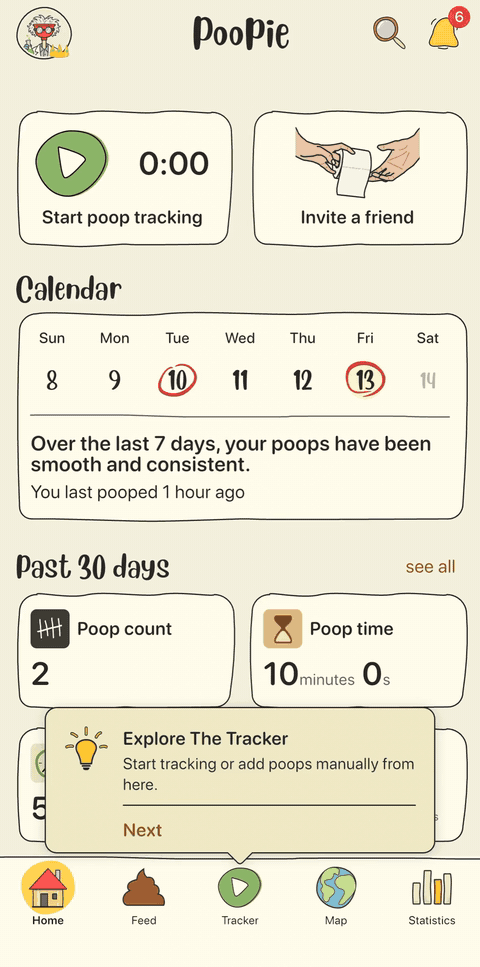

# flutter_tipkit



**[Try the live demo](https://poopieapp.github.io/flutter_tipkit/)**, a
chapter for each feature, from a one-line tip to tours and custom themes.

Contextual feature tips for Flutter: tips with rules, parameters and events,
a display frequency, tip groups, inline and popover tips, and a pluggable
datastore.

Inspired by Apple's [TipKit](https://developer.apple.com/documentation/tipkit).
This is an independent package, not affiliated with or endorsed by Apple.

- **Pure models.** A `Tip` is plain data: an id, its text, its rules and
  options. It never builds widgets. How tips look is up to `TipWidget`,
  `PopoverTipWidget` and `TipTheme`.
- **No dependencies** beyond Flutter. Popovers use Flutter's own
  `OverlayPortal`, so they inherit your theme, localizations and state
  management scopes.
- **Persist anywhere.** Tip state goes through a small `TipDatastore`
  interface. `flutter_tipkit_shared_preferences` provides one for
  shared preferences.

## Installation

```sh
flutter pub add flutter_tipkit
# To keep tip state across app restarts:
flutter pub add flutter_tipkit_shared_preferences
```

## Getting started

Configure once, before the first tip shows:

```dart
Future<void> main() async {
  WidgetsFlutterBinding.ensureInitialized();
  await Tips.configure(
    datastore: SharedPreferencesTipDatastore.async(SharedPreferencesAsync()),
    displayFrequency: TipDisplayFrequency.daily,
    onEvent: (event) => analytics.log(event),
  );
  runApp(const MyApp());
}
```

Define a tip:

```dart
class FavoriteTip extends Tip {
  const FavoriteTip();

  @override
  String get id => 'favorite';

  @override
  TipContent get content => const TipContent(
        title: 'Keep the good ones',
        message: 'Star a note to pin it to the top.',
        actions: [TipAction(id: 'gotIt', label: 'Got it')],
      );

  @override
  List<TipRule> get rules => [
        TipRule.event(addedNote, (donations) => donations.count >= 3),
      ];
}
```

Show it inline, or pointing at a widget:

```dart
const TipWidget(tip: FavoriteTip());

PopoverTipWidget(
  tip: const FavoriteTip(),
  arrowEdge: TipArrowEdge.top, // the arrow points up: opens below the star
  child: IconButton(icon: const Icon(Icons.star), onPressed: favorite),
);
```

The `id` is what the tip's state is stored under: never change it once a tip
has shipped.

## Inline tips

While a tip may not be displayed, `TipWidget` takes no space (it builds a
`SizedBox.shrink`). Give the space around an inline tip in its `padding`, not
in a `Padding` around it, so the space goes away with the tip. In a
`CustomScrollView`, use `SliverTipWidget`, which has no extent while hidden:

```dart
TipWidget(tip: const FavoriteTip(), padding: const EdgeInsets.only(bottom: 12));

SliverTipWidget(tip: const FeedTip(), padding: const EdgeInsets.all(12));
```

## Popovers

A `PopoverTipWidget` adds nothing but two lightweight wrappers around its
child while its tip may not be displayed: the bubble and the barrier exist
only while the tip shows. Only one popover shows at a time; the others wait
until it closes.

- `arrowEdge` is the edge of the tip that carries the arrow, so it also says
  where the tip opens: `top` opens below the target, `bottom` above, `start`
  and `end` beside it. Left out, the tip opens below or above, wherever there
  is more room.
- `arrowAlignment` puts the arrow near the start, centre or end of that edge.
  The tip is shifted to stay on screen, and the arrow follows so it keeps
  pointing at the target.
- `barrierBehavior` says what a tap outside the tip does: `close` (the
  default) invalidates the tip, `dismiss` hides it until the
  `PopoverTipWidget` is rebuilt from scratch, and `block` ignores the tap.

## Only on the visible screen

A `TipWidget` or `PopoverTipWidget` shows its tip only while it is on the
visible screen: its tickers are enabled (so not in an inactive tab kept alive
by an `IndexedStack`-style tab bar) and its route is the current one (so not
under another screen, dialog or bottom sheet). Elsewhere it shows nothing,
counts no displays and does not hold the one-popover slot, so a hidden popover
can never leave a barrier over the visible screen. When the screen comes back,
so does the tip.

## Rules, parameters and events

A tip shows once all its rules hold. Rules can look at parameters, events and
other tips:

```dart
const isLoggedIn = TipParameter<bool>('isLoggedIn', false);
const addedNote = TipEvent('addedNote');

isLoggedIn.value = true; // when it changes
addedNote.donate(); // each time it happens

@override
List<TipRule> get rules => [
      TipRule.parameter(isLoggedIn, (loggedIn) => loggedIn),
      TipRule.event(addedNote, (d) => d.within(const Duration(days: 7)) >= 3),
      TipRule.tipInvalidated(const WelcomeTip(), minAge: const Duration(days: 1)),
    ];
```

- `TipRule.tipInvalidated(other, minAge:)` shows a tip some time after
  another one, at another place in the app. Time-based rules re-evaluate by
  themselves when their time comes.
- `TipRule.allOf`, `anyOf` and `not` combine rules.
- Rules are synchronous and see only tip state: pass anything else in through
  a parameter. Write your own by extending `TipRule`.

## Groups

A `TipGroup` shows its tips one at a time: `TipGroup.ordered` in the order
given, `TipGroup.firstAvailable` whichever is available first.

```dart
final tour = TipGroup.ordered([
  const ComposeTip(),
  if (remoteConfig.showsAttachments) const AttachmentsTip(),
  const SendTip(),
]);

TipWidget.group(tour); // shows the current tip, then the next

// Or show each tip of the group at its own place:
TipWidget(tip: const ComposeTip(), group: tour);
PopoverTipWidget(tip: const SendTip(), group: tour, child: sendButton);
```

A group keeps no state of its own. Its current tip follows from the tips'
stored state, so the order can be decided at runtime and the group resumes
where the user left off. With both `tip:` and `group:`, a view shows its tip
only while it is the group's current one, so a group's tips can point at
different widgets.

## Display frequency and limits

- `displayFrequency` in `Tips.configure` limits how often a tip that has
  never been displayed may appear: `immediate`, `hourly`, `daily`, `weekly`
  or `monthly`. Tips displayed before are not held back.
- `TipOption.ignoresDisplayFrequency()` lets a tip show regardless, for
  example the steps of a tour that follow each other right away.
- `TipOption.maxDisplayCount(n)` invalidates a tip once it has been displayed
  `n` times. Coming back to its screen counts as displaying it again.

```dart
@override
List<TipOption> get options => const [TipOption.maxDisplayCount(3)];
```

## Actions and closing

- A `TipAction` invalidates its tip by default, since "Next" and "Got it" end
  most tips. `invalidatesTip: false` keeps the tip.
- The close button invalidates the tip as closed.
- React to an action where the tip shows, with `onAction: (tip, action)`.
- Invalidate a tip from anywhere once the user did what it suggests:
  `const FavoriteTip().invalidate(TipInvalidationReason.actionPerformed)`.
- `Tips.suppress()` hides every tip for a while, without invalidating any,
  for example while a full-screen dialog is open. Call `release()` on what
  it returns to show them again.

## Customizing the look

There are three levels, from light to full. All of them can be set for a
subtree with `TipTheme` (for example in `MaterialApp.builder`), and the
builders can also be given to a single tip widget.

**1. Restyle the default card** with colors, a gradient, the outline, corner
radius, shadows, arrow shape, text styles and spacing:

```dart
TipTheme(
  data: TipThemeData(
    backgroundColor: colors.surface,
    gradient: null, // or a LinearGradient
    borderSide: BorderSide(color: colors.outlineVariant),
    borderRadius: BorderRadius.circular(16),
    arrowShape: const TipArrowShape.rounded(size: Size(22, 11), tipRadius: 3),
    popoverShadows: const [BoxShadow(blurRadius: 24, spreadRadius: 2)],
    leading: const Icon(Icons.lightbulb_outline),
  ),
  child: child,
)
```

The bubble is a `ShapeBorder`, `TipBubbleBorder`, so it works anywhere a
shape does, for example in your own `ShapeDecoration`. Implement
`TipArrowShape` for arrows the built-in triangle and rounded shapes cannot
draw.

**2. Replace parts** of the card: `leading`, `actionBuilder` (for your own
buttons) and `closeButtonBuilder`.

```dart
TipThemeData(
  actionBuilder: (context, action, onPressed) =>
      TextButton(onPressed: onPressed, child: Text(action.label)),
)
```

**3. Replace the whole card** with `cardBuilder`. The tip widgets still decide
when the tip shows, place popovers and animate them; the builder only draws:

```dart
TipThemeData(
  cardBuilder: (context, details) => MyTipCard(
    title: details.content.title,
    message: details.content.message,
    onClose: details.onClose,
    onAction: details.onAction,
  ),
)
```

To keep a popover's arrow on its target when the tip is shifted to stay on
screen, draw it with a `TipBubble` given `details.arrowPosition`. To decorate
the default card, return `TipCard.fromDetails(details)` inside your own
widgets. `TipBubble`, `TipContentLayout` and `TipActionBar` are public too.

## Animations

`transitionDuration` and `transitionCurve` set the timing. To change the
animation itself, give a `TipTransitionBuilder`, like
`AnimatedSwitcher.transitionBuilder`: `inlineTransitionBuilder` and
`popoverTransitionBuilder` in the theme, or `transitionBuilder` on a widget.

```dart
TipThemeData(
  popoverTransitionBuilder: (context, animation, details, child) =>
      SlideTransition(
        position: Tween(begin: const Offset(0, 0.1), end: Offset.zero)
            .animate(animation),
        child: FadeTransition(opacity: animation, child: child),
      ),
)
```

The animation runs from 0 (hidden) to 1 (shown) and is already curved.
`details.arrowAlignment` says where the arrow is, the natural origin for a
scale. `TipTransitions` has the built-in ones: `reveal` (the inline default),
`scale` (the popover default), `fade` and `slide`.

## Localization

`Tip.content` is read each time the tip renders, so localization that needs no
`BuildContext` works in it directly:

```dart
@override
TipContent get content => TipContent(title: LocaleKeys.favoriteTitle.tr());
```

With context-based localization, provide the content where the tip shows:

```dart
TipWidget(
  tip: const FavoriteTip(),
  content: (context, tip) =>
      TipContent(title: AppLocalizations.of(context).favoriteTitle),
);
```

Set `TipThemeData.closeButtonLabel` to the translated word, so screen readers
announce the default close button in the user's language.

## State management

flutter_tipkit has no state management dependency. It talks in plain Flutter
types, so it fits any of them:

- **Reading:** `Tips.center` is a `Listenable` that notifies on every change,
  and `Tips.statusListenable(tip)` is a `ValueListenable<TipStatus>`. Plain
  reads (`tip.status`, `group.currentTip`, `group.isCompleted`) are
  synchronous.
- **Writing:** set a parameter (`isLoggedIn.value = true`), donate an event
  (`addedNote.donate()`) or invalidate a tip (`tip.invalidate(...)`) from
  wherever your logic lives.

The widgets need nothing else. To use tip state in your own logic:

```dart
// No package at all.
ValueListenableBuilder(
  valueListenable: Tips.statusListenable(const FavoriteTip()),
  builder: (context, status, _) => Text('$status'),
);

// Riverpod.
final tipStatusProvider = Provider.family<TipStatus, Tip>((ref, tip) {
  final status = Tips.statusListenable(tip);
  void onChange() => ref.invalidateSelf();
  status.addListener(onChange);
  ref.onDispose(() => status.removeListener(onChange));
  return status.value;
});

// Feeding a parameter from a provider.
ref.listen(noteCountProvider, (_, count) => noteCount.value = count,
    fireImmediately: true);

// Bloc.
class TipStatusCubit extends Cubit<TipStatus> {
  TipStatusCubit(Tip tip)
      : _status = Tips.statusListenable(tip),
        super(Tips.status(tip)) {
    _status.addListener(_onChange);
  }

  final ValueListenable<TipStatus> _status;

  void _onChange() => emit(_status.value);

  @override
  Future<void> close() {
    _status.removeListener(_onChange);
    return super.close();
  }
}

// provider.
ChangeNotifierProvider.value(value: Tips.center, child: app);
```

Listeners are notified once per microtask, never in the middle of a build, so
updating state from them is safe.

## Persistence

`Tips.configure` loads everything once, keeps it in memory, and writes changes
in the background, one at a time and in order. Implement `TipDatastore` to
store tips anywhere; every value it receives is JSON-encodable. The default,
`InMemoryTipDatastore`, forgets everything on restart.

## Testing

```dart
setUp(Tips.resetForTesting);

testWidgets('shows the tip', (tester) async {
  await Tips.configure();
  Tips.showAllTipsForTesting();
  ...
});
```

`Tips.configure(clock: ...)` replaces the clock for time-based rules, and
`Tips.flush()` waits for pending writes. `Tips.resetDatastore()` clears every
tip's state, for example behind a debug menu item.
